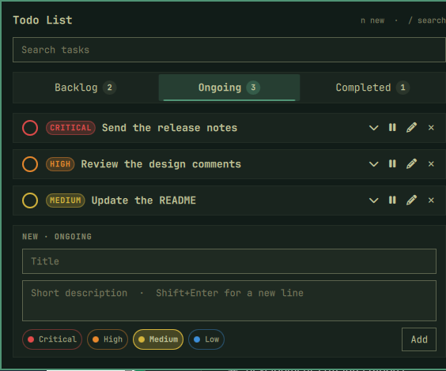
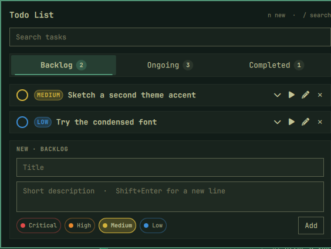
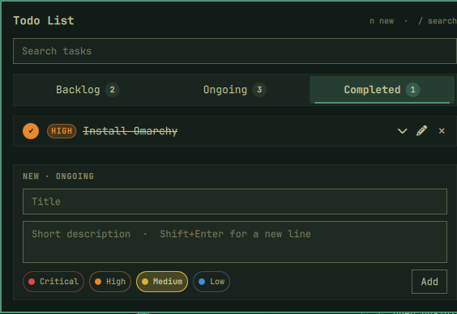

# Todo List

An [Omarchy](https://omarchy.org) bar widget for a short, prioritized todo list.
Notepad icon on the bar, a count badge coloured by the highest ongoing priority,
and a panel that grows with the list then scrolls.



Tasks live only on this machine, in `~/.local/state/omarchy/todos.json`. There
are no extra packages and no network use.

## Install

```bash
omarchy plugin add https://github.com/dejan994/omarchy-priority-todos.git --enable
```

Place it on the bar if the installer does not. Restart the shell once if the
notepad icon does not appear:

```bash
omarchy restart shell
```

## Remove

```bash
omarchy plugin remove dejan94.todos
```

That removes the widget. It does not delete `~/.local/state/omarchy/todos.json`.

## What it does

- **Four priorities**, colour-coded on the checkbox and the priority pill:
  Critical red, High orange, Medium yellow, Low blue. The bar badge uses the
  highest *ongoing* colour; backlog items do not count toward it.
- **Backlog, Ongoing, and Completed** as three tabs. Each list sorts Critical
  first, then High, Medium, Low. New tasks land on the tab you are looking at
  (Ongoing if you are on Completed). Play starts a backlog item; pause parks
  an ongoing item. The circle marks a task complete; unchecking it returns it
  to Ongoing.
- **Search** from the field at the top, or press `/` with the panel open.
- **Add** from the form at the bottom: title, optional description, priority.
  Enter adds the task. Shift+Enter starts a new line in the description.
  `n` focuses the title field.
- **Expand** the chevron to read a description. **Edit** the pencil to change
  title, description, and priority in place. × removes it.

| Backlog | Completed |
| --- | --- |
|  |  |

## Keyboard

| Key | |
| --- | --- |
| `n` | Focus the new-task title |
| `/` | Focus search |
| Left / Right | Cycle Backlog, Ongoing, Completed |
| Enter | Add or save |
| Shift+Enter | New line in a description |
| Escape | Leave a field, then close the panel |

## License

MIT. See [LICENSE](LICENSE). No third-party dependencies beyond Omarchy itself.
