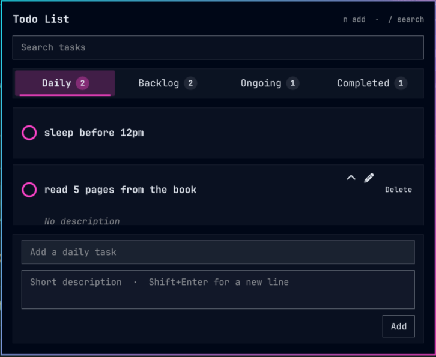

# Todo List

An [Omarchy](https://omarchy.org) bar widget for a short, prioritized todo list.
Notepad icon on the bar, a count badge coloured by the highest ongoing priority,
and a panel that grows with the list then scrolls.


Tasks live only on this machine, in `~/.local/state/omarchy/todos.json`. There
are no extra packages and no network use.

## Install

```bash
omarchy plugin add https://github.com/Aston-lewis/check_ur_todo.git --enable
```

Place it on the bar if the installer does not. Restart the shell once if the
notepad icon does not appear:

```bash
omarchy restart shell
```

## Remove

```bash
omarchy plugin remove aston.todos
```

That removes the widget. It does not delete `~/.local/state/omarchy/todos.json`.

## What it does

- **Four priorities**, colour-coded on the checkbox and the priority pill:
  Critical red, High orange, Medium yellow, Low blue. The bar badge uses the
  highest *ongoing* colour; backlog items do not count toward it.
- **Daily, Backlog, Ongoing, and Completed** as four tabs. Daily tasks keep
  their title and description and reset to incomplete on the next local
  calendar day; completed daily tasks stay visible until deleted. Backlog,
  Ongoing, and Completed keep their existing behavior and sort Critical first,
  then High, Medium, Low. New normal tasks land on the tab you are looking at
  (Ongoing if you are on Completed). Play starts a backlog item; pause parks
  an ongoing item. The circle marks a task complete. The last tab you used
  is remembered.
- **Search** from the field at the top, or press `/` with the panel open.
- **Add** from the field at the bottom. Focus it (or press `n`) to reveal
  description and Add; normal tasks also offer priority selection. Enter adds
  the task. Shift+Enter starts a new line in the description.
- **Click a row** to expand the title and description. Hover a row for edit,
  park/start, and remove. Daily tasks show a labeled Delete action.
  The pencil still opens in-place edit. × removes normal tasks.
- **Completed** is quieter. **Clear** at the bottom right of that tab
  removes every finished normal task.

|Daily | Backlog |
| --- | --- |
|  |  |  |

|Completed |
| --- |
|  |


## Keyboard

| Key | |
| --- | --- |
| `n` | Focus the add field |
| `/` | Focus search |
| Left / Right | Cycle Daily, Backlog, Ongoing, Completed |
| Enter | Add or save |
| Shift+Enter | New line in a description |
| Escape | Leave a field, then close the panel |

## Credits

This project is based on [omarchy-priority-todos](https://github.com/dejan994/omarchy-priority-todos) by [Dejan V.](https://github.com/dejan994).

The original project is licensed under the MIT License. This version includes customizations and additional features, including a Daily Todo tab with automatic daily reset.

## License

MIT. See [LICENSE](LICENSE). No third-party dependencies beyond Omarchy itself.
